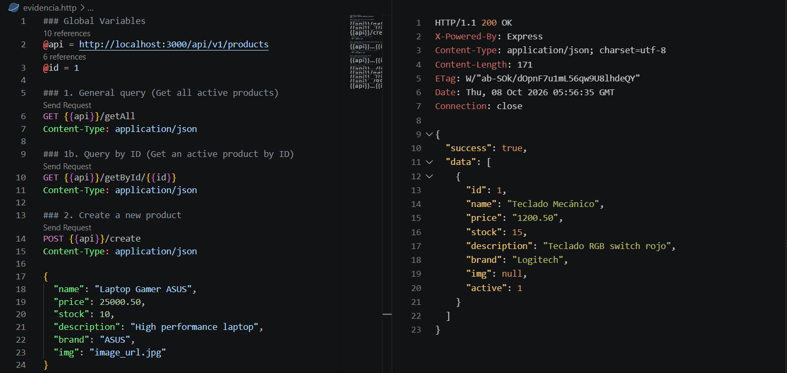
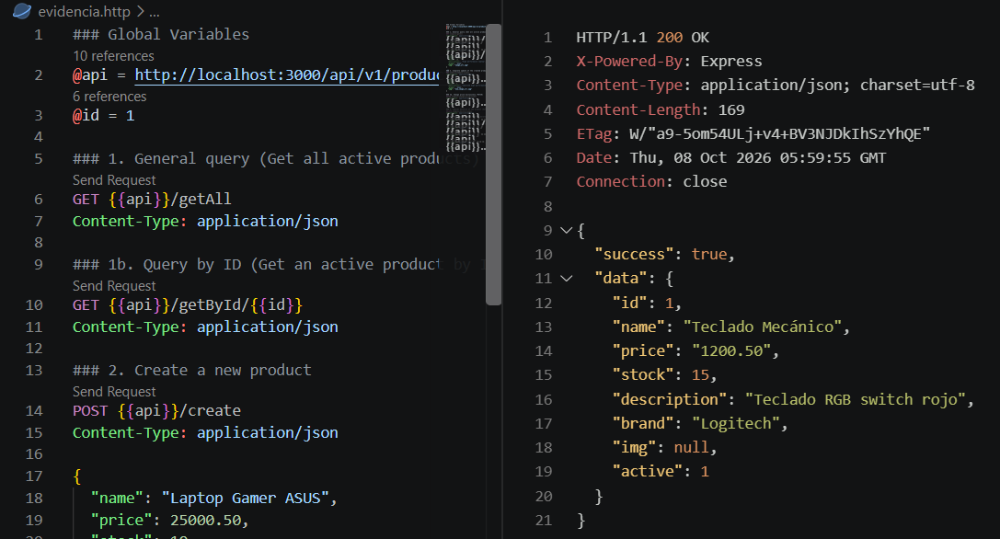
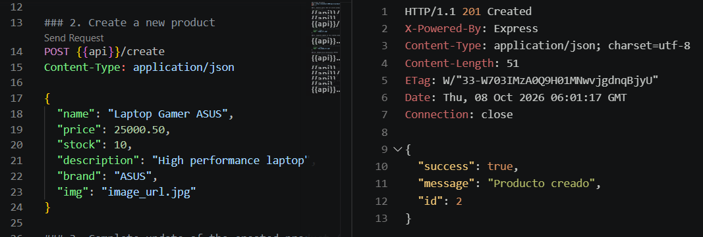
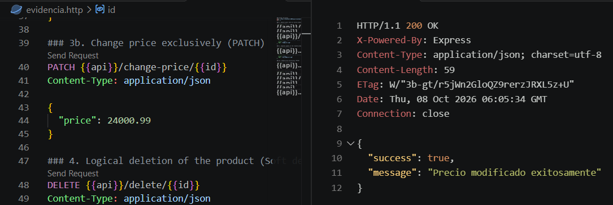
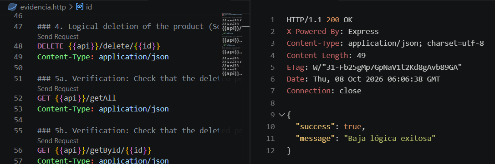
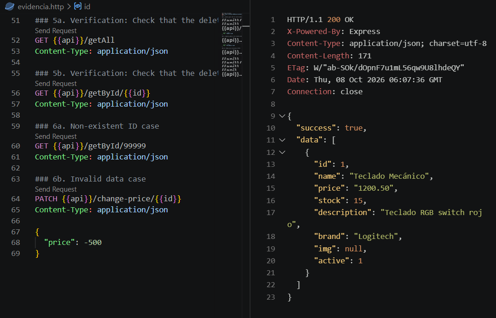
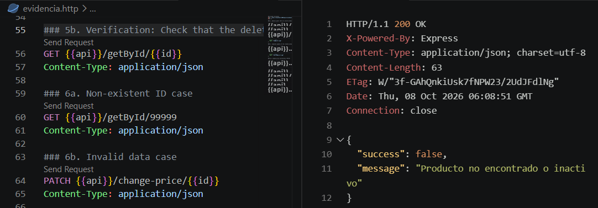
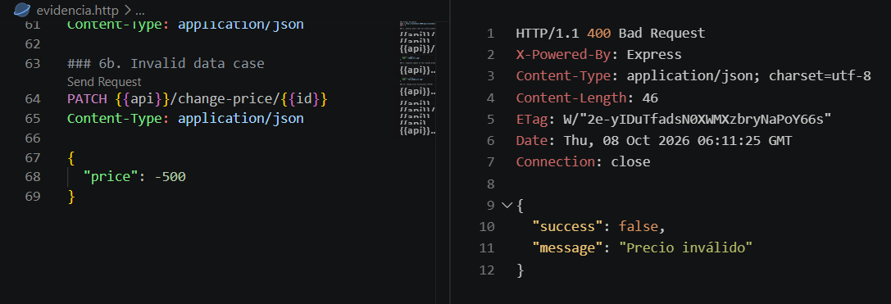
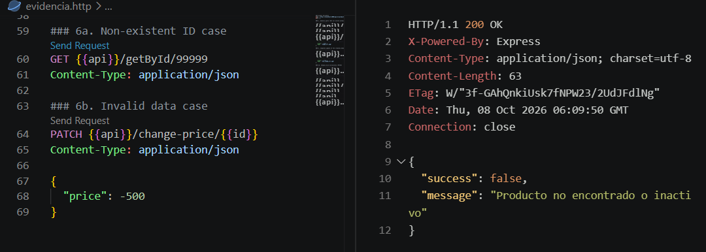

# Activity Evidence: Products REST API

## Point 1: General query and query by ID
General query of active products:

Specific query by ID:

## Point 2: Product creation
A new product was inserted returning a 201 status.

## Point 3: Complete update and price change
Product price update (PATCH):

## Point 4: Logical deletion of the product
The active status was changed to false instead of deleting the record.

## Point 5: Logical deletion verification
Verification that the deleted product no longer appears in getAll query:

Verification that the deleted product is not found in getById query:

## Point 6: Non-existent ID and invalid data cases
Response when entering a negative price (400 Bad Request):

Response when searching for a non-existent ID (200 Status due to special rule):
